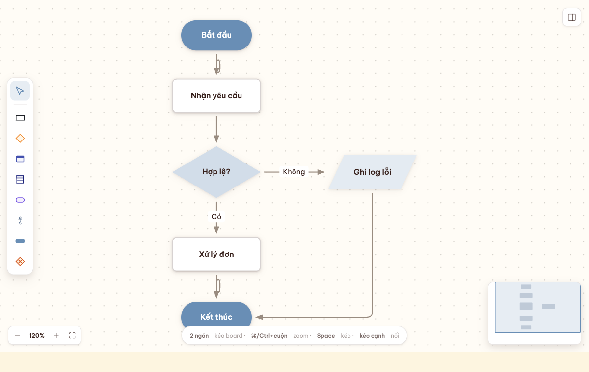
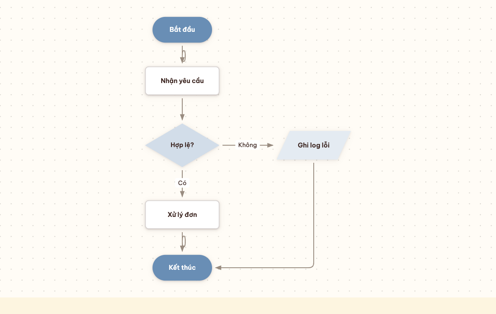
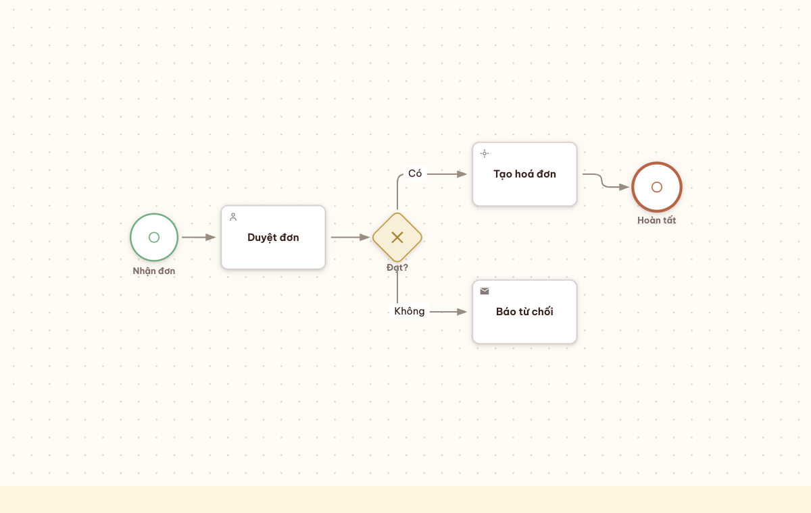
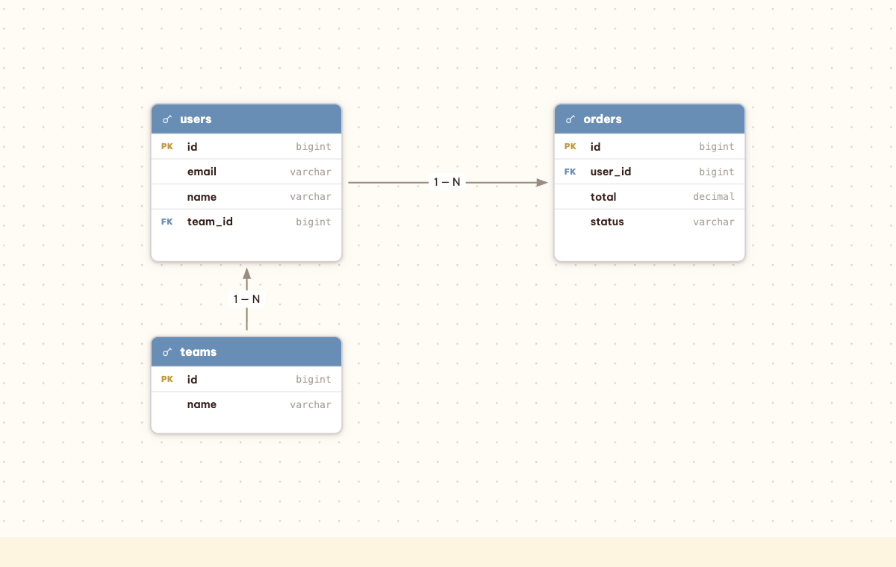
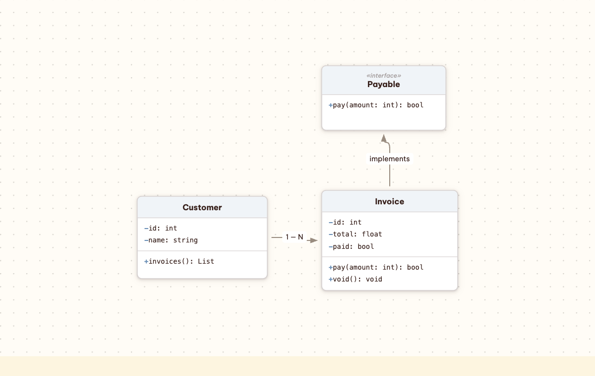
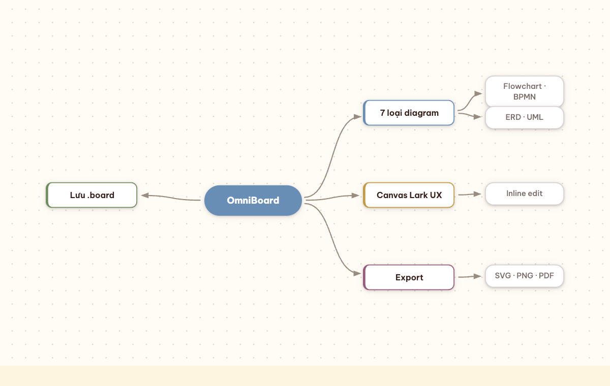
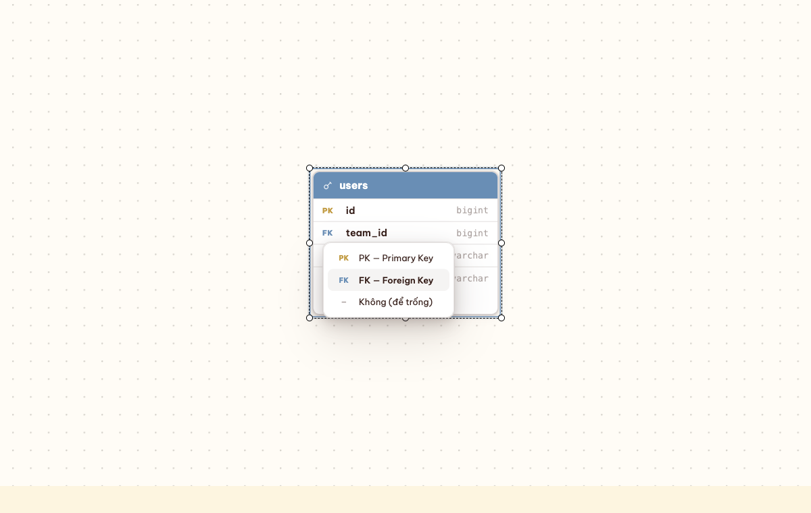

# OmniBoard

> All-in-one diagram board for Obsidian — **Flowchart, BPMN, ERD, UML, Sequence, State and Mindmap** in one board file.

OmniBoard turns Obsidian into a WYSIWYG diagram editor. Click the ribbon, get a full-screen canvas (Excalidraw-style), drag shapes, connect them with smart routed arrows, and edit text inline — all saved to a plain-JSON `.board` file that stays git-friendly and searchable.



---

## ✨ Highlights

- **7 diagram families in one board** — mix Flowchart, BPMN, ERD, UML, State, Sequence and Mindmap on the same canvas.
- **Drag-and-drop canvas** built on [AntV X6](https://x6.antv.antgroup.com/) — smart manhattan connectors, port hover, alignment guides, multi-select, pan/zoom (trackpad-friendly).
- **Inline editing everywhere** — double-click to edit table titles, columns, class names, fields/methods, pool/lane labels, edge labels. No modal, no sidebar required.
- **bpmn.io-quality BPMN** — events / gateways / tasks / pools with lanes, drawn in HTML/CSS (no heavy bpmn-js dependency).
- **Auto-layout** — one click for a clean Sugiyama (dagre) arrangement, LR or TB.
- **Export** — SVG, PNG (1×/2×/4×), PDF (A4), and *Copy as Mermaid*.
- **Read-mode embed** — `![[diagram.board]]` renders a static preview with an *Open* button.
- **Warm "AI productivity" theme** — dotted canvas, soft accents, Be Vietnam Pro. Vietnamese UI.

---

## 🧩 Diagram types

| Flowchart | BPMN |
|---|---|
|  |  |

| ERD | UML |
|---|---|
|  |  |

| Mindmap | Inline key picker |
|---|---|
|  |  |

Plus **Sequence** (actor / participant / activation / fragments) and **State Machine** (initial / state / choice / final).

---

## ✏️ Inline editing

Data-driven shapes are editable directly on the canvas — no properties panel needed:

- **ERD** — double-click the table title, a column name or type; click a key cell to pick **PK / FK / none** from a menu.
- **UML** — double-click the class/interface name, or any field/method line.
- **BPMN** — double-click a pool/lane band or an event/gateway label.

Double-click to edit, **Enter** to commit, **Shift+Enter** for a new line, **Esc** to cancel.

---

## 📦 Installation

**Manual:**

1. Download `main.js`, `manifest.json` and `styles.css` from a release (or build them — see below).
2. Copy them into `<your-vault>/.obsidian/plugins/omniboard/`.
3. Reload Obsidian → **Settings → Community plugins** → enable **OmniBoard**.

**BRAT (beta):** add `pieofmind/obsidian-omniboard` in the [BRAT](https://github.com/TfTHacker/obsidian42-brat) plugin.

---

## 🚀 Usage

1. Click the **New board** ribbon icon (or run the command) → a `Board <timestamp>.board` file opens full-screen.
2. Drag shapes from the left rail onto the canvas.
3. Drag from a node's port to another node to connect; drop on empty space to pick a follow-up shape.
4. Select a node → the floating toolbar lets you change shape, colors, typography and border.
5. Double-click any label to edit it inline.
6. Use the export menu in the top bar for SVG / PNG / PDF / Mermaid.

Embed a board into a note with `![[Board ….board]]`.

**Handy keys:** `Cmd/Ctrl+Z` / `Shift+Z` undo/redo · `Cmd/Ctrl+D` duplicate · `Cmd/Ctrl+A` select all · `Cmd/Ctrl+C/X/V` copy/cut/paste · `Delete` remove · `Esc` cancel.

---

## 💾 Save format

A board is a single `.omniboard.md` file — plain Markdown so Obsidian's link graph, search and read-mode all keep working. The plugin reads/writes three optional fenced code blocks inside a `%%`-comment fold:

| Block | Role | Contents |
|---|---|---|
| ```` ```omniboard-data ```` | **Master** | `CanvasModel { nodes, edges }` (pako-compressed JSON). The source of truth — every save regenerates other blocks from this one. |
| ```` ```omniboard-bpmn-xml ```` | **Derived** | Raw BPMN 2.0 XML, regenerated eagerly on each save when the canvas is BPMN-shaped. Enables the BPMN Native view to open the same wrapper file without converting to a separate `.bpmn` file. |
| ```` ```omniboard-source-meta ```` | Optional | Side data preserved from an original import (e.g. unmapped BPMN elements). |

**Master rule:** `omniboard-data` always wins. If you hand-edit the raw `omniboard-bpmn-xml` block in a text editor, your edits are discarded the next time the BoardView saves — the canvas master is re-exported into that block. Treat the XML block as a cache.

**Switching views.** Open a `.omniboard.md` in BoardView and click the "Switch to BPMN Native view" toolbar button (or run the `Omniboard: Switch to BPMN Native view` command) to flip the same leaf to the BPMN modeler — no file conversion, no second file. The reverse button appears in the BPMN Native toolbar only when viewing a wrapper file. Raw `.bpmn` files keep their existing one-view behaviour, and the `Omniboard: Convert .bpmn to Omniboard wrapper` command pairs an existing `.bpmn` into a fresh `<name>.omniboard.md`.

---

## 🛠️ Development

```bash
npm install
npm run build      # tsc strict + esbuild → main.js
npm run dev        # watch mode
npm test           # vitest round-trip suite
```

To test in Obsidian, symlink (or copy) this repo into a vault's plugins folder:

```bash
ln -s "$(pwd)" "<your-vault>/.obsidian/plugins/omniboard"
```

**Visual harness** (iterate UI without launching Obsidian):

```bash
npx esbuild harness/harness.ts --bundle --format=iife --outfile=harness/harness.js
python3 -m http.server 8755     # then open harness/index.html
```

The harness renders a `OmniboardCanvas` with sample diagrams — the screenshots in this README were captured from it via Playwright.

---

## 🗺️ Roadmap

- [ ] Automated round-trip tests (parse ↔ serialize) for every type
- [ ] Trim bundle (drop jsPDF in favor of a print-window export)
- [ ] Edge styling polish + verified line jumps
- [ ] Lane-aware auto-layout (children snap to BPMN lanes)
- [ ] i18n (English + Vietnamese)
- [ ] Submit to the Obsidian Community Plugins directory

---

## 📐 Architecture in one breath

One X6 `html-node` renders every shape via a `foreignObject` + `nodeHtml(kind, label, style, extra)`, so nodes match the design pixel-for-pixel while X6 handles model, edges, ports, selection and connectors. See the in-vault design notes for the full decision log.

---

## 📄 License

MIT © [Pie Of Mind](https://github.com/nguyenkalix84)

Built with [AntV X6](https://github.com/antvis/X6), [dagre](https://github.com/dagrejs/dagre) and [jsPDF](https://github.com/parallax/jsPDF).
